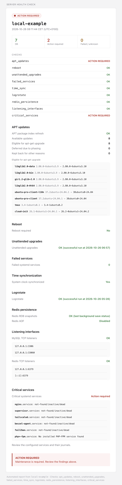

# Server Health Checker

[](https://github.com/maarsson-io/server-health-check/releases)
[](https://releases.ubuntu.com/)
[](https://github.com/maarsson-io/server-health-check/blob/master/LICENSE)

A lightweight tool for weekly health reports from Ubuntu servers.
It performs checks only, and will not install package updates or reboot servers.

## Installation

Requires Ubuntu Linux, Bash, systemd, Git, curl, and `distro-info`.

1. Clone the project, create a shortcut, and configure the server:

   ```sh
   # Clone repository to the server
   sudo git clone https://github.com/maarsson-io/server-health-check.git /opt/server-health-check
   # Create shortcut
   sudo ln -s /opt/server-health-check/bin/server-health-check /usr/local/bin/server-health-check
   # Create and edit the config file
   # Set the server name, Mailgun settings, and optional checks
   sudo server-health-check init-config
   sudoedit /etc/server-health-check.conf
   sudo server-health-check validate-config
   ```

   Keep credentials outside Git. The config must remain `root:root` with mode `0600`.

2. Test email delivery and review a report, confirm arrival before scheduling:

   ```sh
   # Test email delivery
   sudo server-health-check test-email
   # Test reporting, without sending report email
   sudo server-health-check report --without-sending
   # Final test
   sudo server-health-check report
   ```

3. Schedule weekly reporting:

   ```sh
   cd /opt/server-health-check
   sudo install -o root -g root -m 0644 systemd/server-health-check.service systemd/server-health-check.timer /etc/systemd/system/
   sudo systemctl daemon-reload
   sudo systemctl enable --now server-health-check.timer
   systemctl list-timers --all server-health-check.timer
   ```

Reports run Sundays at 04:30 in the server's timezone, including when healthy.
Missed schedules run after downtime. Keep the checkout root-owned and not writable by other users.

## Performed checks

| Command | Purpose and configuration |
| --- | --- |
| `check-apt-index` | Refresh APT metadata; repository failures and lock conflicts are unknown. |
| `check-apt-updates` | Refresh metadata and simulate an upgrade; list eligible, phased, `apt-mark hold`, and other held-back packages. Phased and on-hold packages alone require no action. |
| `check-reboot` | Check Ubuntu's reboot-required marker. |
| `check-unattended-upgrades` | Verify the daily scheduler and a successful unattended-upgrades run within 36 hours. |
| `check-failed-services` | List failed system-wide systemd services. |
| `check-critical-services` | Verify configured services are running or sockets are listening. Set `CRITICAL_SERVICES` to comma-separated `.service` or `.socket` names. (`php*-fpm.service` includes all installed PHP-FPM versions). Default: `none`. |
| `check-ubuntu-eol` | Warn when Ubuntu standard support ends within 90 days or has expired. Uses local `distro-info-data`. |
| `check-time-sync` | Check whether the system clock is synchronized. |
| `check-logrotate` | Verify the logrotate timer and a successful run within 36 hours. |
| `check-redis-persistence` | Check RDB/AOF failure states. Requires `redis-cli` and `REDIS_ENABLED=true`; set `REDIS_HOST`/`REDIS_PORT`. Currently supports passwordless connections only. Disabled persistence is accepted. |
| `check-listening-interfaces` | Inspect enabled MySQL/Redis TCP listeners. Set `MYSQL_ENABLED`/`REDIS_ENABLED`, `MYSQL_LISTEN_PORTS`/`REDIS_PORT`, and each service's `*_ALLOWED_LISTEN_ADDRESSES`. Defaults allow MySQL on 127.0.0.1 and Redis on 127.0.0.1/::1. |
| `check-git-up-to-date` | Compare the current commit with the live upstream branch; requires root's Git authentication. Any commit difference requires attention. Does not update code. |
| `check-all` | Run all applicable checks and print a summary without sending email. |
| `report` | Run the same checks and send plain-text/HTML email, even when healthy or a check fails. `--without-sending` previews the email as text; checks still run. |

`init-config` also appends missing settings without changing existing values.
`self-update` fast-forwards the current branch from its upstream, then runs the updated `init-config`; a clean checkout is required.
See `server-health-check --help` and [config/config.example](config/config.example) for settings.

## Example report mail

<center>
   
</center>

## Troubleshooting

Run `server-health-check --help` for available commands and exit codes.

Errors go to stderr and the system log, tagged `server-health-check`. Scheduled output is also in the service journal:

```sh
sudo journalctl -t server-health-check --since today --no-pager
sudo journalctl -u server-health-check.service --since today --no-pager
```

Failed checks do not stop other checks or the email delivery attempt.
Missing emails can indicate server, scheduler, or delivery failure. This is not a replacement for external monitoring.

## License

[MIT](LICENSE)
